# `google-cloud-storage-uds`: Thin Python SDK over Rust gRPC Unix Domain Socket & Zero-Copy Shared Memory

This package implements a Proof-of-Concept (PoC) for `google-cloud-storage` inspired by the **Cloud Bigtable Accelerator** embedded IPC sidecar architecture. Instead of linking Rust into the Python interpreter via PyO3/FFI, a 100% pure-Python client (`AsyncUdsStorageClient` / `UdsStorageClient`) communicates over a local **Unix Domain Socket (`unix:///...`)** with a standalone Rust gRPC server binary (`gcs-accelerator-server`) built on the official `google-cloud-storage` Rust SDK (`1.20.0`) and `tonic` (`0.14.6`).

To eliminate the socket serialization and copy tax on large payloads, the client and server also support a **Zero-Copy Shared Memory (`mmap` over `/dev/shm`)** data plane alongside the UDS gRPC control plane.

## Architecture

```mermaid
flowchart LR
    subgraph PythonProcess["Python Application Process (100% Pure Python)"]
        App["User Code"]
        Client["AsyncUdsStorageClient / UdsStorageClient"]
        Arena["SharedMemoryArena (mmap /dev/shm)"]
        Stub["StorageAcceleratorStub (grpc.aio)"]
        App --> Client
        Client --> Stub
        Client --> Arena
    end

    subgraph IPC["Local IPC Channels"]
        UDS["Control Plane: Unix Domain Socket (AF_UNIX)"]
        SHM["Data Plane: POSIX Shared Memory (/dev/shm)"]
    end

    subgraph RustSidecar["Rust Sidecar Process (gcs-accelerator-server)"]
        Tonic["Tonic HTTP/2 gRPC Server"]
        ShmCache["Persistent mmap Cache (SHM_CACHE)"]
        Tokio["Multi-Threaded Tokio Runtime (4 workers)"]
        Storage["google_cloud_storage::client::Storage (HTTP/JSON)"]
        Tonic --> Tokio
        Tokio --> ShmCache
        Tokio --> Storage
    end

    Stub <==>|"Tiny Control Protobufs"| UDS
    UDS <==> Tonic
    Arena <==>|"Zero-Copy Physical RAM Pages"| SHM
    SHM <==> ShmCache
    Storage <==>|"HTTPS / JSON API"| GCS[("Google Cloud Storage")]
```



## Key Components

- **[proto/storage_accelerator.proto](proto/storage_accelerator.proto)**: Defines the `StorageAccelerator` gRPC service (`Ping`, `ReadRanges`, `ReadObjectStream`, `WriteObject`, `ListObjects`) including shared-memory zero-copy descriptors (`shm_path`, `shm_offset`, `actual_lengths`).
- **[src/main.rs](src/main.rs)**: Standalone Rust gRPC server binary (`gcs-accelerator-server`) supporting both pipelined 4 MiB UDS streaming (`ReadObjectStream`) and zero-copy POSIX `mmap` transfers (`ShmMapping` + `SHM_CACHE`).
- **[google/cloud/storage_uds/server_manager.py](google/cloud/storage_uds/server_manager.py)**: Manages sidecar process discovery, startup readiness handshake, PID tracking (`/tmp/gcs_accelerator_<uid>.pid`), `/proc/<pid>` CPU & RSS telemetry, and optional persistent reuse across clients.
- **[google/cloud/storage_uds/client.py](google/cloud/storage_uds/client.py)**: Thin async (`AsyncUdsStorageClient`) and sync (`UdsStorageClient`) Python clients supporting both standard socket transport (`zero_copy=False`) and zero-copy shared memory (`zero_copy=True` / `read_ranges_zerocopy`).
- **[benchmarks/bench_json_workload.py](benchmarks/bench_json_workload.py)**: Live 4-way HTTP/JSON benchmark suite comparing Pure Python (`python_json`), Rust UDS gRPC over Socket (`rust_uds_grpc`), Rust UDS Zero-Copy Shared Memory (`rust_uds_zerocopy`), and Rust PyO3 FFI (`rust_pyo3_ffi`).
- **[EVALUATION.md](EVALUATION.md)**: Detailed architectural evaluation and 4-way benchmark analysis.

## Quickstart

```bash
cd packages/google-cloud-storage-uds

# 1. Build the standalone Rust UDS sidecar binary
cargo build --release

# 2. Run the end-to-end unit test suite (14 tests including zero-copy SHM)
PYTHONPATH=. ../../.venv/bin/pytest tests/test_storage_uds.py -v

# 3. Run the live 4-way HTTP/JSON benchmark suite against princer-flat
PYTHONPATH=. GCS_JSON_BUCKET=princer-flat ../../.venv/bin/python benchmarks/bench_json_workload.py
```
